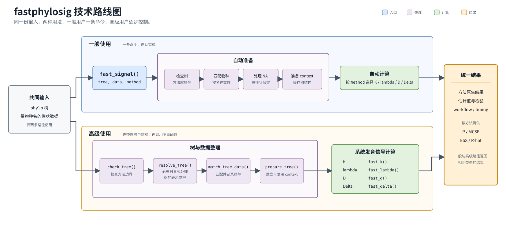
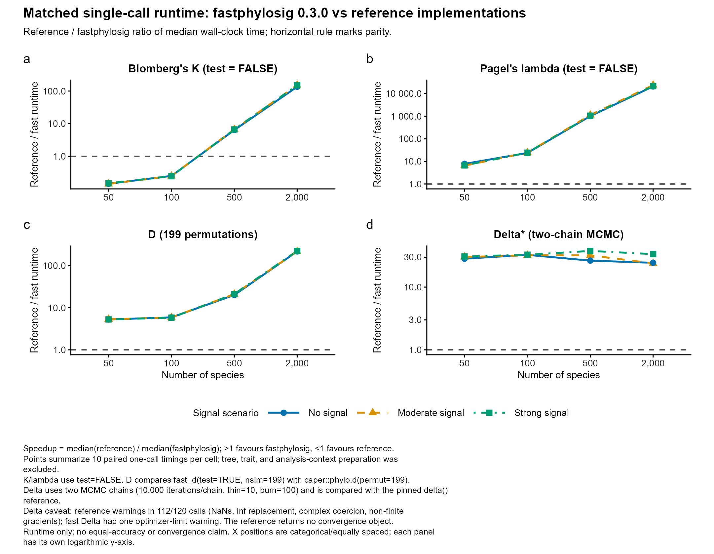
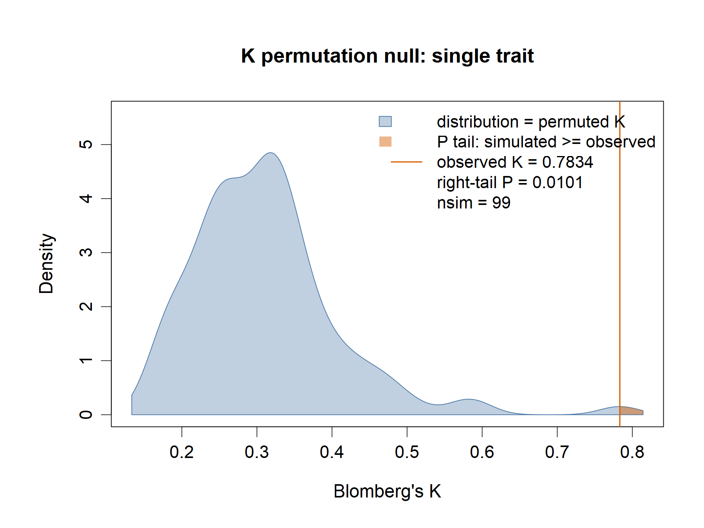
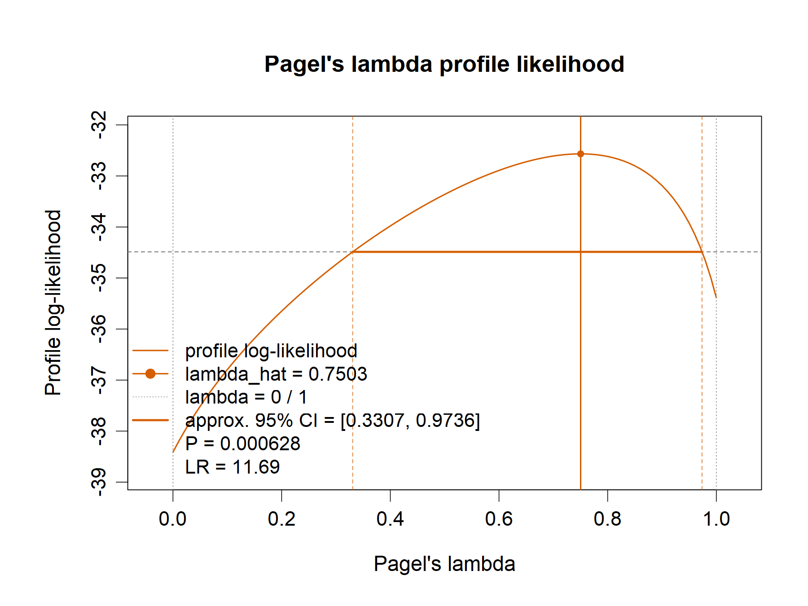

# fastphylosig

Fast phylogenetic signal analysis for continuous, binary and multistate traits in R. Use `fast_signal()` to select K, lambda, D or Delta, and `fast_hetero()` to compare clade-level signal and map patterns of phylogenetic conservatism. C++ kernels, batch input and reusable tree contexts support large trees and repeated analyses.

With optimized C++ kernels, fastphylosig is up to **23,591 times faster** than standard implementations such as phytools and caper (lambda on a 2,000-species tree, compared with phytools), and is particularly suited to large phylogenetic trees with more than 10,000 tips.

[Website](https://yinwen-ecology.github.io/fastphylosig/) · [中文指南](USAGE_zh.md) · [fast_hetero case study](https://yinwen-ecology.github.io/fastphylosig/fast-hetero-case.html)

**Current release: [0.3.5](https://github.com/yinwen-ecology/fastphylosig/releases/tag/v0.3.5).** This patch corrects ARD full-tree ancestral probabilities and ER/ARD ACE rate standard errors. See the [patch notes and reanalysis guidance](docs/release-0.3.5/RELEASE_NOTES_en.md) for affected outputs.

## Install

Requires R ≥ 4.1.0 and a C++ toolchain, such as Rtools matching your R version on Windows. OpenMP is optional. The release passed CI on Linux, Windows and macOS, including a build without OpenMP.

```r
# Install dependencies on first use
install.packages(c("ape", "Rcpp", "RcppArmadillo"))
install.packages(
  "https://github.com/yinwen-ecology/fastphylosig/releases/download/v0.3.5/fastphylosig_0.3.5.tar.gz",
  repos = NULL, type = "source"
)
library(fastphylosig)

# Alternatively, install the fixed release tag
# install.packages("remotes")
# remotes::install_github("yinwen-ecology/fastphylosig@v0.3.5")
```

## Start with one command

Provide a `phylo` tree and named trait data, then select the method explicitly:

```r
set.seed(1)
tree <- ape::rtree(30)
trait <- setNames(stats::rnorm(30), tree$tip.label)

fit <- fast_signal(tree, data = trait, method = "K", progress = FALSE)
summary(fit)
```

`fast_signal()` checks the tree, matches species and handles missing values per trait before running the selected method.

| Method | Selector | Traits | Estimates and tests |
|---|---|---|---|
| Blomberg's K | `"K"` | Continuous | K; optional tip-randomization test |
| Pagel's lambda | `"lambda"` | Continuous | ML estimate; optional likelihood-ratio test against lambda = 0 |
| Fritz–Purvis D | `"D"` | Binary | D; random-association and Brownian-threshold null tests |
| Delta | `"Delta"` | Multistate categorical | Delta, MCMC diagnostics; optional tip-randomization test |

Inspect results with `print()`, `summary()` or `as.data.frame()`. Plotting requires the corresponding saved simulations or likelihood profile, as shown below.

## Workflow and specialist functions



For explicit preparation and reusable tree calculations:

```r
checked <- check_tree(tree, signal = "K")          # Read-only inspection
tree_ready <- resolve_tree(tree, signal = "K")    # Edge order and node numbering
matched <- match_tree_data(tree_ready, data = trait)
ctx <- prepare_tree(matched$tree)
```

| Function | Main controls |
|---|---|
| `fast_k()` | Custom permutations, block processing and null retention |
| `fast_lambda()` | Likelihood profiles and approximate confidence intervals |
| `fast_d()` | Random/Brownian state inputs and null retention |
| `fast_delta()` | Multivariate traits; ER/ARD models, MCMC chain length and sampling controls (`mcmc_sim`, `thin`, `burn`), and convergence diagnostics |
| `fast_ace()` | Discrete ancestral-state ML estimates and rate standard errors |

```r
fit_k <- fast_k(ctx, x = matched$data, test = TRUE, nsim = 999,
                return_sim = TRUE, progress = FALSE)
fit_lambda <- fast_lambda(ctx, trait, test = TRUE,
                          lambda_profile = TRUE, progress = FALSE)

binary <- setNames(as.integer(trait > stats::median(trait)), names(trait))
fit_d <- fast_d(ctx, binary, nsim = 999,
                return_sim = TRUE, keep_null = TRUE, progress = FALSE)

# Delta: for multivariate, discrete traits
categorical <- setNames(rep(c("a", "b", "c"), length.out = length(trait)),
                        names(trait))
fit_delta <- fast_delta(ctx, categorical, test = TRUE, nsim = 99,
                        mcmc_sim = 10000, thin = 10, burn = 100,
                        return_sim = TRUE, progress = FALSE)
```

`fast_delta()` defaults to ARD; the clade example below explicitly selects ER. Choose models and simulation budgets for the study design. The 99 permutations above are a quick demonstration.

For repeated analyses, pass multiple traits as a matrix/data frame and reuse `ctx`. Prepared contexts support `saveRDS()`/`readRDS()`; prepare them again after changing the source tree.

## Runtime benchmarks



On 2,000-species trees, observed median reference/fastphylosig runtime ratios were **135–151× for K**, **20,697–23,591× for lambda** and **218–224× for D**. Tree/data preparation is excluded; each scenario has 10 matched pairs. Gains depend on the workload, and small-tree K can be slower than phytools.

Delta returned-call ratios were 23.9–33.6×, with numerical warnings in 112/120 reference calls and one fast fit reaching an optimizer limit. These timings do not establish equal accuracy or convergence. See [benchmark settings, raw records and diagnostics](docs/release-0.3.0/README.md).

## Compare signal across clades

`fast_hetero()` selects maximal disjoint crowns within size bounds, or accepts explicit internal nodes. It reports local estimates, sample sizes, missingness, categorical state composition and coverage, with optional whole-tree signal and reference tests of clade dispersion.

This separate 256-species example provides several crowns within the requested 50–100-tip range:

```r
set.seed(2)
tree_h <- ape::stree(256, type = "balanced")
tree_h$edge.length <- rep(1, nrow(tree_h$edge))
trait_h <- ape::rTraitCont(tree_h)
binary_h <- ape::rTraitDisc(tree_h, model = "ER", k = 2, rate = 0.15)
categorical_h <- ape::rTraitDisc(tree_h, model = "ER", k = 3, rate = 0.15)

h <- fast_hetero(
  tree_h, trait_h, method = "K", min_tips = 50, max_tips = 100,
  test = TRUE, nsim = 999, overall_test = TRUE, progress = FALSE
)
h$clades                    # Local estimates, sample sizes and diagnostics
h$heterogeneity             # Dispersion and reference test
h$overall                   # Whole-tree estimate and ordinary signal test
h$selection$coverage
nodes <- h$selection$nodes  # Reuse the same crowns across methods

plot(h, tree = tree_h, node_labels = TRUE)
plot(h, tree = tree_h, type = "fan")

hl <- fast_hetero(tree_h, trait_h, method = "lambda", nodes = nodes,
                  min_tips = 50, test = TRUE, nsim = 999,
                  overall_test = TRUE, progress = FALSE)
hd <- fast_hetero(tree_h, binary_h, method = "D", nodes = nodes,
                  min_tips = 50, test = FALSE, d_nsim = 1000,
                  overall_test = TRUE, progress = FALSE)
hdelta <- fast_hetero(tree_h, categorical_h, method = "Delta", nodes = nodes,
                      min_tips = 50, test = FALSE, overall = TRUE,
                      delta_control = list(model = "ER"), progress = FALSE)
hdelta$clades[, c("node", "estimate", "n_states", "log_ratio_overall")]
hdelta$clades$state_counts
plot(hdelta, tree = tree_h)
```

<details>
<summary><strong>Choose crowns and interpret results</strong></summary>

- Use `nodes` for prespecified biological groups, or size bounds for an automatic scan. Inspect coverage, sample sizes and crown ages. Explicit nodes override automatic size selection; `min_tips` still applies after NA removal.
- `overall = TRUE` adds the whole-tree estimate; `overall_test = TRUE` adds its ordinary signal test; `clade_test = TRUE` adds ordinary tests for each crown. These are separate from the heterogeneity reference enabled by `test = TRUE`. `overall_nsim`/`clade_nsim` control K/Delta ordinary tests; D uses `d_nsim`.
- Tree colours show local signal. Annotations summarize already computed overall and heterogeneity results; `show_summary = FALSE` hides them. Plotting does not rerun tests. Select `trait = "column_name"` for a multi-trait result.

| Method | Dispersion summary | Heterogeneity reference and current use |
|---|---|---|
| K | `SD(log K)` | BM reference; `P_BM` and its common alias `P_heterogeneity`. Shaded envelopes are BM reference ranges. |
| lambda | `SD(lambda)` | Approximate common-local-crown Gaussian reference, using pooled REML by default. Interpret alongside crown age and cut scale. |
| D | `SD(D)` | Local/overall description recommended; shared symmetric ER inference conditional on crown state counts remains experimental (`test = TRUE`). |
| Delta | `SD(log Delta)`, local/overall log ratios and RMS | Local/overall description and diagnostics recommended; heterogeneity tests remain experimental research interfaces. |

Local differences describe conservatism patterns at the analysed scale. Ordinary signal P values and heterogeneity P values answer different questions; one significant and one nonsignificant signal P value do not establish a clade difference.

Heterogeneity tests require at least two non-overlapping crowns. Nested nodes support descriptive scans with `test = FALSE`. Single-state D/Delta crowns remain unavailable rather than being assigned zero. Retain failures and fit/MCMC diagnostics with the estimates.

The [worked case study](https://yinwen-ecology.github.io/fastphylosig/fast-hetero-case.html) includes downloadable data, results and R code. See the [fast_hetero workflow](docs/fast-hetero-roadmap.md) and [method notes](docs/signal-heterogeneity-zh.md) (Chinese) for additional detail.

</details>

## Tree and data requirements

- **Trees:** K/D require finite positive lengths; D supports rooted polytomies but rejects unary nodes. Lambda permits valid zero internal branches but rejects zero terminal branches. Delta/ACE require rooted, fully bifurcating trees with positive lengths. `resolve_tree()` normalizes edge order and node numbering; root/outgroup choice remains with the user.
- **Traits:** use unique vector names or matrix/data-frame row names. Unnamed input assumes tree-tip order. Missing values are handled per trait; measurement-error input is currently unsupported (`se = NULL`).

## Plotting and visualization

| K permutation null (example) | Lambda likelihood profile (example) |
|---|---|
|  |  |

```r
plot_signal(fit_k)
plot_signal(fit_lambda)
plot_signal(fit_d)
plot_signal(fit_delta)
```

K and Delta plots use saved randomization distributions; D overlays both null distributions; lambda displays its likelihood profile and approximate interval. For null plots, set `test = TRUE, return_sim = TRUE`; D also requires `keep_null = TRUE`. Lambda uses `lambda_profile = TRUE`.

<details>
<summary><strong>Inference and MCMC diagnostics</strong></summary>

- **Delta:** the estimate is posterior `mean(beta / alpha)`. Inspect `ESS_Delta`, `split_Rhat_Delta`, `MCSE_Delta` and available rank diagnostics, plus successful permutations and `MCSE_P` when testing. Defaults are ARD, `mcmc_sim = 10000`, `thin = 10`, `burn = 100`, `test = FALSE`.
- **D:** null simulations standardize D even when `test = FALSE`. Results include `MCSE_P_random` and `MCSE_P_Brownian`. In `fast_hetero()`, `d_nsim` controls this standardization and `nsim` controls optional heterogeneity simulation.

</details>

<details>
<summary><strong>Performance and reproducibility</strong></summary>

- **Efficiency:** batch traits, reuse prepared contexts and retain null distributions only when needed. `progress = FALSE` silences progress/matching messages while retaining statistical warnings and timing metadata.

<details>
<summary><strong>Parallel execution and reproducibility</strong></summary>

- **Parallel reproducibility:** K randomization and binary-tree D use OpenMP threads; Delta permutations use R workers, controlled by `ncores`. Fix seeds, controls, explicit simulation inputs (if supplied) and `ncores`. Changing Delta worker count can change random-stream allocation.
- **ACE threads:** large ACE fits within Delta/clade scans automatically use at most two OpenMP threads. `options(fastphylosig.ace_threads = 1L)` forces serial evaluation; `0L` restores automatic selection. This setting does not reallocate random streams.

</details>

</details>
