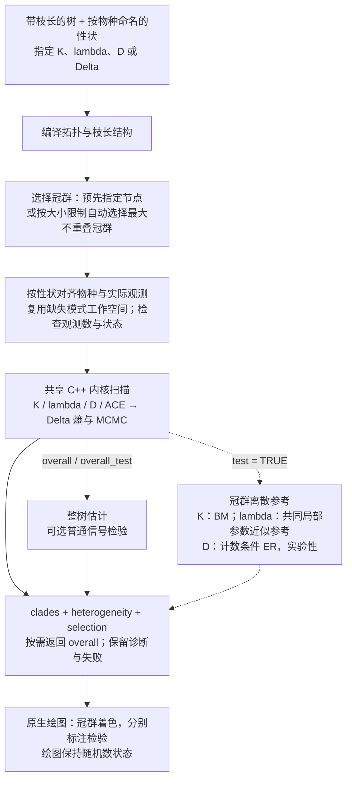

# fast_hetero() 技术路线

[案例](fast-hetero-case-zh.html#workflow) · [SVG 路线图](fast-hetero-roadmap-zh.svg) · [English](fast-hetero-roadmap.md)

实线表示局部信号描述主流程，虚线表示按需增加的总体分析与冠群间参考检验。本图对应 v0.3.4 的推荐流程。

实现由 `heterogeneity_plan_cpp()` 规划冠群、`heterogeneity_scan_cpp()` 扫描实际观测，复用指标内核及保留的工作空间。K 共享编译后的对比与置换路径，λ 共享似然计算器，D 共享对比和参考模拟内核，Δ 共享 ACE 似然与祖先概率路径，以及熵和 MCMC 内核。实现细节见 [R 调度](https://github.com/yinwen-ecology/fastphylosig/blob/v0.3.4/R/signal_heterogeneity.R)与 [C++ 源码](https://github.com/yinwen-ecology/fastphylosig/tree/v0.3.4/src)。

Δ 的推荐流程为 `test = FALSE`，按需启用 `overall = TRUE` 或 `overall_test = TRUE`，不纳入 Δ 异质性推断。`clade_test` 单独控制可选的局部普通信号检验。D 原有的随机/Brownian 参考与新增实验性异质性参考分别解释。

主切割按生物学类群或树上大小范围预先确定，优先比较年龄与实际样本量相近的冠群，保留覆盖度和不可用冠群，再以少量预定尺度做敏感性比较。异质性参考检验要求不重叠冠群；显式指定的嵌套节点仅支持描述。具体统计解释见案例及完整范围指南。

SVG 由 [build-hetero-roadmap.py](release-0.3.4/build-hetero-roadmap.py) 生成，中英文共享同一布局；上面的 Mermaid 可独立编辑。
