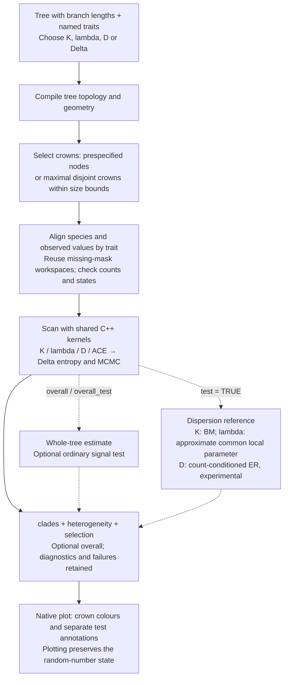

# fast_hetero() technical workflow

[Case study](fast-hetero-case.html#workflow) · [SVG diagram](fast-hetero-roadmap.svg) · [中文](fast-hetero-roadmap-zh.md)

The solid path provides local signal descriptions. Dashed paths add whole-tree analysis or a between-crown reference test when requested. This diagram documents the recommended v0.3.4 workflow.

The implementation uses `heterogeneity_plan_cpp()` for crown planning and `heterogeneity_scan_cpp()` for the observed scan. It reuses the method kernels and retained workspaces rather than preparing every subtree again through repeated public R calls. K shares the compiled contrasts/permutation path, λ the likelihood evaluator, D the contrast and calibration kernels, and Δ the ACE likelihood/ancestral-probability path plus entropy and MCMC kernels. See [R orchestration](https://github.com/yinwen-ecology/fastphylosig/blob/v0.3.4/R/signal_heterogeneity.R) and the [C++ implementation](https://github.com/yinwen-ecology/fastphylosig/tree/v0.3.4/src).

For the recommended Δ workflow, use `test = FALSE` and request `overall = TRUE` or `overall_test = TRUE` as needed. Δ heterogeneity inference is outside this workflow. `clade_test` separately controls optional ordinary local signal tests. D's original random/Brownian calibrations are distinct from its experimental heterogeneity reference.

Choose the primary partition from biological groups or tree-based size bounds before inspecting trait results. Prefer crowns of comparable ages and observed sample sizes, retain coverage and unavailable crowns, and examine a small set of prespecified scales. Heterogeneity references require disjoint crowns; nested explicit nodes support description only. The worked example and full scope guide give the statistical interpretation.

The SVG is generated by [build-hetero-roadmap.py](release-0.3.4/build-hetero-roadmap.py). Both languages share one layout. The Mermaid above is editable independently.
